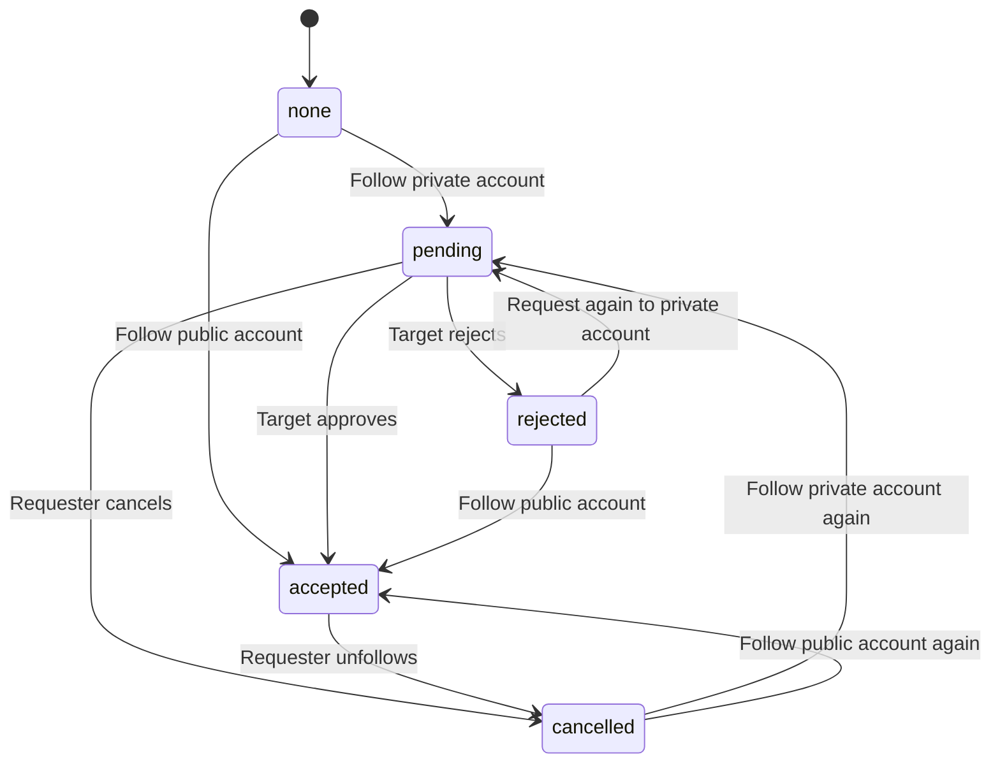

# Follow State Machine and Concurrency Testing

## 1. Purpose

This document describes the follow relationship state machine, its valid and invalid transitions, and the concurrency test used to verify that duplicate follow requests cannot create duplicate database rows.

## 2. Follow Relationship States

A follow relationship can have four states:

| State | Meaning |
|---|---|
| `pending` | Follow request is waiting for approval |
| `accepted` | Follow relationship is active |
| `rejected` | Target account rejected the request |
| `cancelled` | Requester cancelled the request or unfollowed |

A relationship that does not exist is represented as `none`.

## 3. State-machine diagram



## 4. Transition permissions

| Current state | Operation | Next state | Allowed? |
|---|---|---|---|
| none | Follow private account | pending | Yes |
| none | Follow public account | accepted | Yes |
| pending | Approve | accepted | Yes |
| pending | Reject | rejected | Yes |
| pending | Cancel | cancelled | Yes |
| accepted | Unfollow | cancelled | Yes |
| accepted | Approve again | accepted | No |
| accepted | Reject | rejected | No |
| rejected | Approve | accepted | No |
| rejected | Reject again | rejected | No |
| cancelled | Approve | accepted | No |
| cancelled | Reject | rejected | No |

A new follow request from a rejected or cancelled state is allowed. Its resulting state depends on whether the target account is private or public.

## 5. Authorization rules

- Only the requester can cancel their own follow request.
- Only the target account can approve a request.
- Only the target account can reject a request.
- Users cannot follow themselves.
- A follow request to a disabled or nonexistent account must fail.
- Only pending requests can be approved or rejected.

## 6. Illegal transition tests

Create tests for these cases:

| Test | Expected result |
|---|---|
| Approve an already accepted relationship | Conflict |
| Reject an already accepted relationship | Conflict |
| Approve a rejected request | Conflict |
| Reject a rejected request again | Conflict |
| Approve a cancelled request | Conflict |
| Reject a cancelled request | Conflict |
| Cancel a nonexistent relationship | Not following / idempotent result |
| Follow yourself | Bad request |

The approval and rejection operations must update only rows currently in the `pending` state.

Expected SQL condition:

```sql
WHERE follower_id = $1
  AND following_id = $2
  AND status = 'pending'
```

If no row is updated, inspect the existing relationship and return the appropriate result.

## 7. Concurrent follow request test

### Objective

Send 50 concurrent follow requests using the same follower ID and target ID.

Expected result:

- All requests must not create duplicate relationship rows.
- Only one row must exist for the follower-target pair.
- For a public target, the final status should be `accepted`.
- For a private target, the final status should be `pending`.

### Test script

Create `scripts/test-concurrent-follow.js`:

```js
const followerId = process.env.FOLLOWER_ID;
const targetId = process.env.TARGET_ID;
const sessionCookie = process.env.SESSION_COOKIE;

if (!followerId || !targetId || !sessionCookie) {
  throw new Error(
    'Set FOLLOWER_ID, TARGET_ID and SESSION_COOKIE',
  );
}

async function main() {
  const requests = Array.from(
    { length: 50 },
    () =>
      fetch(
        `http://localhost:3000/users/${targetId}/follow`,
        {
          method: 'POST',
          headers: {
            Cookie: sessionCookie,
          },
        },
      ),
  );

  const responses = await Promise.all(requests);

  const results = await Promise.all(
    responses.map(async (response) => ({
      statusCode: response.status,
      body: await response.text(),
    })),
  );

  console.log('Total requests:', results.length);
  console.log(
    'Successful responses:',
    results.filter((r) => r.statusCode >= 200 &&
      r.statusCode < 300).length,
  );

  console.log('Responses:', results);
}

main().catch(console.error);
```

Run it with your test account details:

```bash
FOLLOWER_ID=your-follower-uuid
TARGET_ID=your-target-uuid
SESSION_COOKIE="your-session-cookie"
node scripts/test-concurrent-follow.js
```

Set the cookie to the actual session cookie name and value issued by your login endpoint.

### Database verification

After the test, run:

```sql
SELECT
    follower_id,
    following_id,
    status,
    COUNT(*) AS row_count
FROM follows
WHERE follower_id = 'YOUR_FOLLOWER_UUID'
  AND following_id = 'YOUR_TARGET_UUID'
GROUP BY follower_id, following_id, status;
```

Expected result: exactly one row for that pair.

Also verify directly:

```sql
SELECT COUNT(*) AS total_rows
FROM follows
WHERE follower_id = 'YOUR_FOLLOWER_UUID'
  AND following_id = 'YOUR_TARGET_UUID';
```

Expected:

```text
total_rows
----------
1
```

## 8. Why duplicate rows are prevented

The `follows` table uses a composite primary key:

```sql
PRIMARY KEY (follower_id, following_id)
```

The follow request uses:

```sql
ON CONFLICT (follower_id, following_id)
DO UPDATE SET ...
```

When multiple requests arrive simultaneously:

1. The first request inserts the relationship.
2. Other requests encounter the same composite key.
3. PostgreSQL handles the conflict using `ON CONFLICT`.
4. The existing relationship is updated or preserved.
5. Only one database row remains for that pair.
